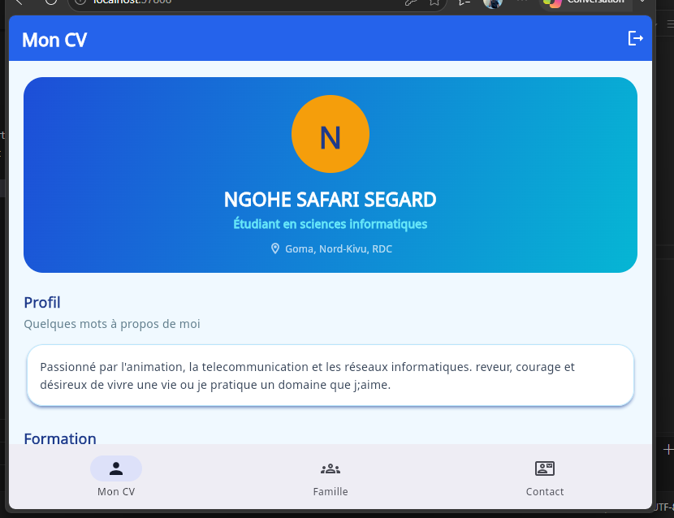
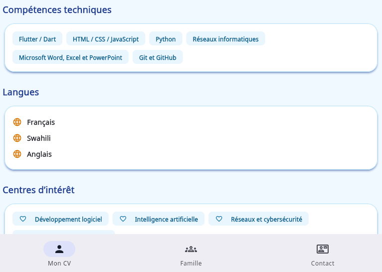
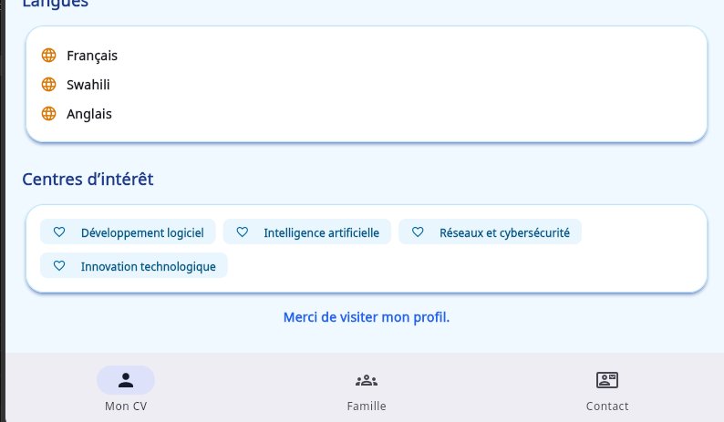

# CV Flutter - Ngohe Safari Segard

Application mobile développée avec Flutter et Dart.

## Présentation

Cette application permet de découvrir mon parcours académique,
mes expériences, mes compétences, ma famille et mes coordonnées.

## image

## video

https://github.com/user-attachments/assets/92995bc7-db6a-4e98-afa1-25b38d8f63a7

https://github.com/user-attachments/assets/392b7747-e780-44af-a8f3-aaf63c2d048d

